<a href="https://chrysanthe.dev">
  <picture>
    <source media="(prefers-color-scheme: dark)" srcset="assets/terminal-dark.svg">
    
  </picture>
</a>

  

 

I ship **native mobile apps and the servers behind them**, from the first commit to store review. Four years building iOS, Android and backend systems, with a focus on native performance, API design and CI/CD pipelines that keep releases boring (in the best way).

## Featured builds

<table>
  <tr>
    <td width="33%" valign="top">
      
      <h3><a href="https://projects.chrysanthe.dev/linked-mac">Linked Mac</a></h3>
      
Mac · Android · 2026

      
Link an Android phone to a Mac over the local network.

      <code>React Native</code> <code>Electron</code>
    </td>
    <td width="33%" valign="top">
      
      <h3>Medica</h3>
      
iOS · Android · Backend · Dashboard

      
Schedule doctor appointments and get medical consultations online, across mobile apps, an API and a dashboard.

      <code>React Native</code> <code>Node.js</code> <code>Supabase</code>
    </td>
    <td width="33%" valign="top">
      
      <h3><a href="https://chrysanthe.dev">chrysanthe.dev</a></h3>
      
Web · 2026

      
My portfolio: a terminal-styled site with every project, the full stack and how to reach me.

      <code>Next.js</code> <code>TypeScript</code> <code>Tailwind</code>
    </td>
  </tr>
</table>

## The stack I ship with

| Area | Tools |
| :-- | :-- |
| **Mobile** |      |
| **Frontend** |      |
| **Backend** |      |
| **Platform** |       |

## Activity

<picture>
  <source media="(prefers-color-scheme: dark)" srcset="https://streak-stats.demolab.com/?user=chrysloi&background=111318&border=1f2330&stroke=1f2330&ring=00e5c8&fire=00e5c8&currStreakNum=e4e8f0&sideNums=e4e8f0&currStreakLabel=00e5c8&sideLabels=a3abbb&dates=7e8698">
  
</picture>

  

<picture>
  <source media="(prefers-color-scheme: dark)" srcset="https://raw.githubusercontent.com/chrysloi/chrysloi/output/snake-dark.svg">
  
</picture>

  

Available for contract work, co-founder conversations and the occasional interesting problem. Say hi at <a href="https://chrysanthe.dev">chrysanthe.dev</a>.

